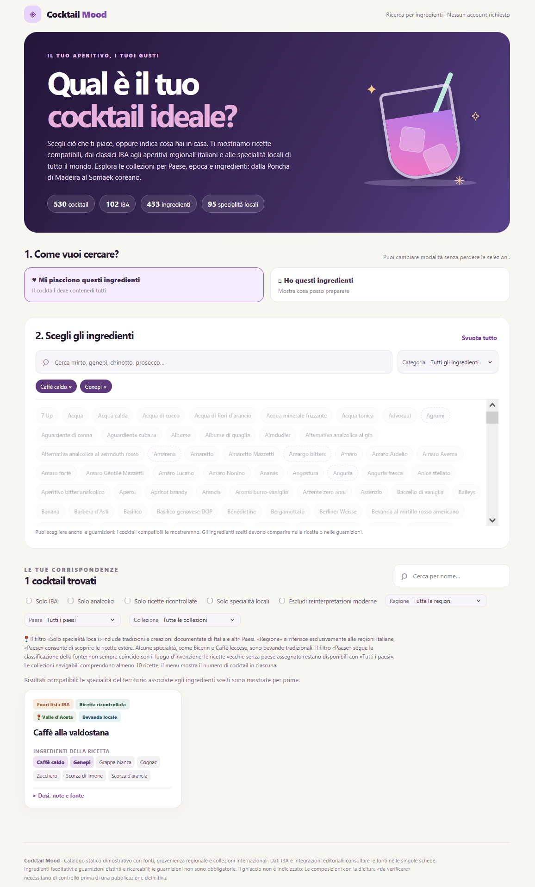

# Cocktail Mood 🍸

**Il cocktail giusto parte da ciò che ti piace — o da quello che hai in casa.**

Cocktail Mood è un catalogo di ricette da esplorare per ingredienti, gusti e provenienza: dai grandi classici agli aperitivi regionali italiani, fino alle specialità del mondo.

**Scopri Cocktail Mood online:** [archistico.github.io/Cocktail/](https://archistico.github.io/Cocktail/)

## Cosa puoi fare

Scegli gli ingredienti che preferisci oppure quelli che hai già in dispensa e scopri cosa preparare. Cerca per nome, esplora le collezioni e filtra per cocktail IBA, analcolici, Paese o regione italiana. Ogni scheda presenta ingredienti, dosi, preparazione e guarnizioni, quando disponibili.

## Il catalogo in numeri

| | |
|---|---:|
| **Ricette** | **530** (102 IBA, 428 altre) |
| **Ricette analcoliche** | 29 |
| **Specialità legate alle regioni italiane** | 57, da 20 regioni |
| **Paesi rappresentati** | 36 |
| **Collezioni tematiche** | 26 |
| **Ingredienti di base** | 433 |
| **Voci selezionabili, guarnizioni comprese** | 474 |

## Ricette e fonti

**518 ricette** sono state confrontate con fonti individuate; **6** hanno una verifica parziale e **6** richiedono ancora conferma. Dove esistono più varianti, la scheda distingue la formula scelta e segnala le incertezze.

**Cocktail Mood è consultabile gratuitamente, senza registrazione, anche offline.**

## Anteprima

